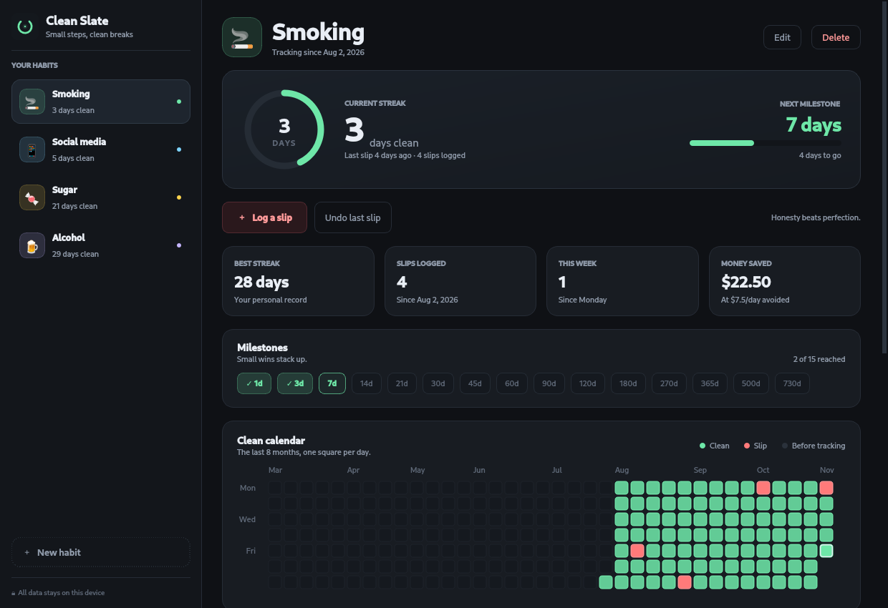

# Clean Slate

A calm, local-first tracker for quitting bad habits. The desktop app is built
with Python, PyQt6 and SQLite; the Android app uses Kivy and the same SQLite
schema and streak math. No accounts, no cloud, no telemetry.



## What it does

- **Habit tracking** for anything you want to quit: smoking, sugar, social media, alcohol, gambling, or a custom habit.
- **Clean streaks** with best-streak records, milestone badges (1 day → 2 years), and a progress ring toward the next milestone.
- **One-tap slip logging** with time, trigger and an optional note. No shame, just data.
- **Clean calendar** heatmap of the last 8 months, plus weekly slip chart and trigger insights.
- **Money saved** estimate based on the daily spend you avoid.
- **Undo last slip** and per-entry deletion for honest bookkeeping.
- **Everything stored locally** in a single SQLite file.

## Download (Linux)

Don't want to set up Python? Grab the portable build from the [v1.0.0 release](https://github.com/burtonwill055-hash/clean-slate/releases/tag/v1.0.0):

```
clean-slate-1.0.0-linux-x86_64.tar.gz
```

Extract it and run `./clean-slate`. It bundles Python, PyQt6 and Qt, so no system packages are needed. There is also an optional `install-menu.sh` inside the folder.

## Android

The Android app lives in [`mobile/`](mobile/) and is built with Kivy. It has the
same Today / History / Habits flow, stores everything locally, and needs no
Android permissions.

- **Requirements:** Android 7.0+ on a 64-bit ARM phone.
- **Download:** `clean-slate-1.0.0-android-arm64-debug.apk` from the
  [Android v1.0.0 release](https://github.com/burtonwill055-hash/clean-slate/releases/tag/android-v1.0.0).
- **Install:** open the APK and allow installs from your browser or file
  manager, or run `adb install -r clean-slate-1.0.0-android-arm64-debug.apk`.

This is a debug-signed APK for direct installation; it is not on Google Play.
Build and development notes are in [`mobile/README.md`](mobile/README.md).

## Run it

Requires Python 3.10+ with PyQt6 (`python3 -c "import PyQt6"` to check). If it is missing:

```bash
python3 -m pip install -r requirements.txt
```

Then:

```bash
./run.sh
```

or:

```bash
cd clean-slate
python3 -m clean_slate
```

The app opens with a few quick-start presets; choose one or create a custom habit.

## Install to the application menu (optional)

```bash
./install.sh
```

This writes `~/.local/share/applications/clean-slate.desktop` and installs the icon into your hicolor theme. To remove it later:

```bash
rm ~/.local/share/applications/clean-slate.desktop \
   ~/.local/share/icons/hicolor/scalable/apps/clean-slate.svg
```

## Your data

Stored at:

```
~/.local/share/clean-slate/clean-slate.db
```

(On other platforms, Qt's generic data directory is used.) Delete that file to start fresh. Back it up by copying it while the app is closed.

## How streaks are counted

A streak is the number of full calendar days since the last slip (or since you started tracking). A slip today resets the current streak to zero and begins a new one tomorrow. Best streak is the longest gap between slips, so it is never reduced by a relapse.

## Project layout

```
clean_slate/
  app.py        main window, pages and navigation
  db.py         SQLite schema, queries and streak math
  dialogs.py    habit editor, slip logger, confirmations
  widgets.py    heatmap, charts, rings, rows and layout helpers
  theme.py      palette and global stylesheet
  assets/       app icon and dropdown chevron
mobile/         Android app (Kivy, same storage/streak logic)
run.sh          launcher
install.sh      optional desktop-menu installer
```

## Notes

- No test data is created on first launch.
- Dark theme only, on purpose.
- Tested on Linux with Qt 6.8 / Python 3.13.

## Development

The app has no build step. Storage/streak logic and the UI can be checked without touching real data:

```bash
python3 dev/test_db.py
QT_QPA_PLATFORM=offscreen python3 dev/test_ui.py
QT_QPA_PLATFORM=offscreen python3 dev/screenshot.py   # writes /tmp/opencode/clean-slate-shots
```

`dev/` also contains layout and ASCII-preview helpers used while building the UI.

For the Android app:

```bash
cd mobile
xvfb-run -a -s "-screen 0 420x900x24" .venv/bin/python dev/test_ui.py
```

See [`mobile/README.md`](mobile/README.md) for the APK build steps.

## License

MIT — see [LICENSE](LICENSE).
