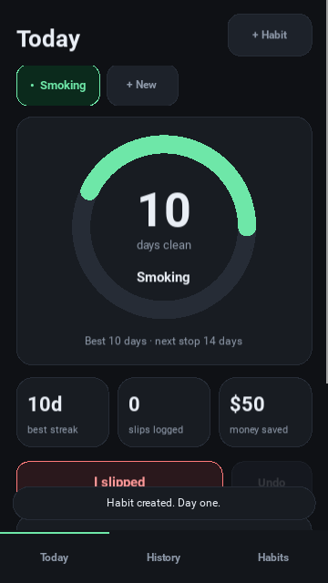
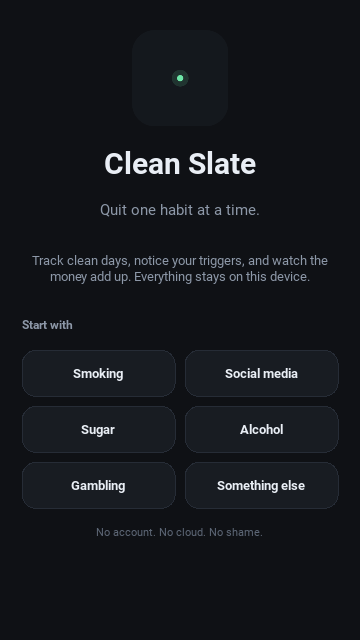
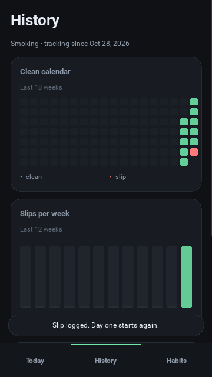

# Clean Slate for Android

The Android companion to [Clean Slate](../README.md): a calm, local-first tracker
for quitting one habit at a time. Same SQLite schema, same streak math, same
promise — no account, no cloud, no telemetry.



## What it does

- **One habit at a time**, with a streak ring, best-streak record and milestone
  progress (1 day → 2 years).
- **Today screen** with clean days, slips this run, money saved, next milestone
  and the last slip.
- **Slip logging** with a trigger chip and an optional note, plus undo.
- **History** with an 18-week clean calendar, 12-week slip chart, trigger
  breakdown and a deletable slip log.
- **Habits** screen to add, edit, switch or delete habits.
- **Everything stays in app-private storage** on the phone.

| Welcome | History |
| --- | --- |
|  |  |

## Requirements

- Android 7.0 (API 24) or newer.
- 64-bit ARM device (`arm64-v8a`). This covers essentially every phone sold
  since 2017; 32-bit-only devices are not built here.

The app requests **no Android permissions** and has no network code. Android
cloud backup is disabled (`android.allow_backup = False`).

## Install

Grab the APK from the [Android v1.0.0 release](https://github.com/burtonwill055-hash/clean-slate/releases/tag/android-v1.0.0):

```
clean-slate-1.0.0-android-arm64-debug.apk
```

Open it on the phone and allow installs from your browser or file manager when
prompted. With `adb`:

```bash
adb install -r clean-slate-1.0.0-android-arm64-debug.apk
```

This is a debug-signed build. It installs directly, but it is not published on
Google Play; Play requires a developer account and a release-signed bundle.

## Your data

The database lives in the app's private files directory, so other apps cannot
read it and it disappears when you uninstall. It is never synced.

For development you can point the app at another file:

```bash
CLEAN_SLATE_DB=/tmp/clean-slate.db .venv/bin/python main.py
```

The schema is shared with the desktop app, so a copy of the desktop
`clean-slate.db` can be dropped in place if you want to inspect it.

## Develop on the desktop

Kivy runs as a normal desktop window, which is much faster to iterate on than
redeploying an APK.

```bash
python3 -m venv .venv
.venv/bin/pip install "kivy==2.3.1" "buildozer==1.6.0" "cython<4" pillow
.venv/bin/python main.py
```

The window defaults to a 420×900 phone shape. Override it while testing:

```bash
CS_UI_WIDTH=360 CS_UI_HEIGHT=640 .venv/bin/python main.py
```

Headless interaction test (clicks real buttons, exercises add/slip/undo/edit/
delete, and checks rendered frames):

```bash
xvfb-run -a -s "-screen 0 420x900x24" .venv/bin/python dev/test_ui.py
```

Screenshots are written to `/tmp/opencode/cs-mobile-shots`.

## Build the APK

Buildozer downloads the Android SDK, NDK and python-for-android on the first
run (several GB, 15–40 minutes). Java 17 or 21 is required; Java 21 is used
below.

```bash
# One-time host tools on Debian/Ubuntu:
# sudo apt-get install git zip unzip openjdk-21-jdk autoconf libtool \
#     pkg-config zlib1g-dev libncurses5-dev libncursesw5-dev libtinfo6 \
#     cmake libffi-dev libssl-dev

python3 -m venv .venv
.venv/bin/pip install "buildozer==1.6.0" "cython<4"

PATH="$PWD/.venv/bin:$PATH" \
VIRTUAL_ENV="$PWD/.venv" \
JAVA_HOME=/usr/lib/jvm/java-21-openjdk-amd64 \
.venv/bin/buildozer -v android debug
```

Output:

```
bin/cleanslate-1.0.0-arm64-v8a-debug.apk
```

The relevant settings live in [`buildozer.spec`](buildozer.spec): package
`org.cleanslate.cleanslate`, target API 34, minimum API 24, portrait,
`arm64-v8a`, Kivy 2.3.1. API 34 is deliberate: Android 15 forces edge-to-edge
layout when an app targets API 35, and SDL2 2.30 does not account for system
bar insets. Sideloaded apps do not need to meet Play's newer target API
requirements.

To use a physical phone:

```bash
adb devices
adb install -r bin/cleanslate-1.0.0-arm64-v8a-debug.apk
adb logcat | grep -i -E "python|kivy|cleanslate"
```

Debug APKs are signed with Buildozer's debug key (`~/.android/debug.keystore`
by default). Keep that file if you want future builds to upgrade the installed
app; a build signed with a different key must be uninstalled first, which also
erases the app's local database.

## Project layout

```
main.py         app, screens, dialogs and navigation
widgets.py      cards, pills, streak ring, heatmap, charts
storage.py      SQLite schema, queries and streak math (shared with desktop)
theme.py        palette, presets, triggers and milestones
assets/         launcher icon and presplash
buildozer.spec  Android packaging settings
dev/test_ui.py  headless end-to-end UI test
docs/           screenshots
```

## Notes

- The UI avoids emoji glyphs on Android (which render inconsistently); habits
  use a colored initial instead.
- The Android back button closes an open dialog, then returns to Today.
- Portrait only, dark theme only, by design.
- This is a separate UI from the PyQt6 desktop app. Only `storage.py` is shared
  logic; it is copied from `clean_slate/db.py` with a mobile-friendly database
  path.

## License

MIT — see [LICENSE](../LICENSE).
